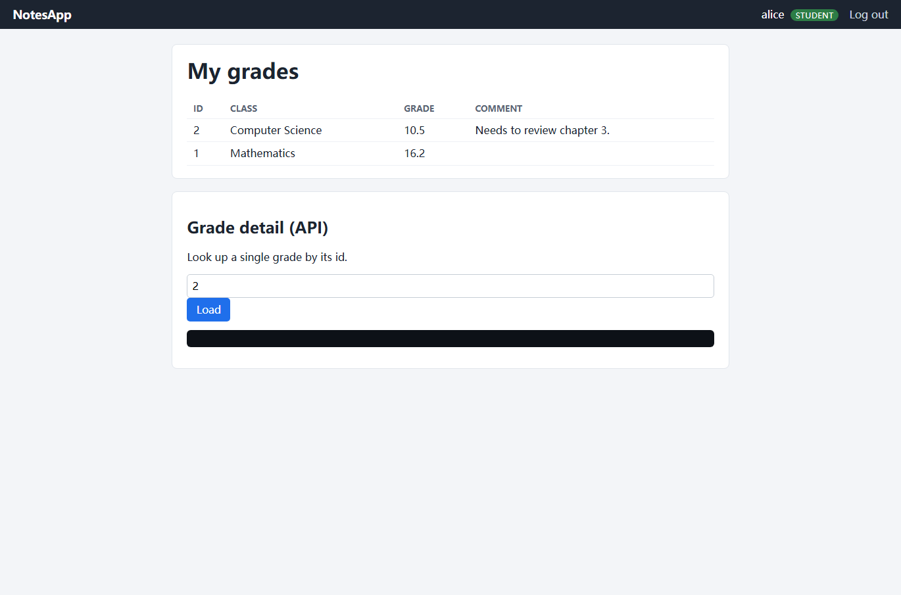
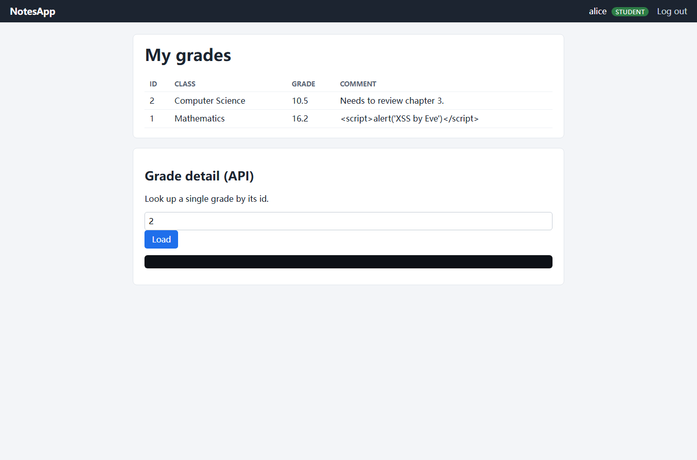
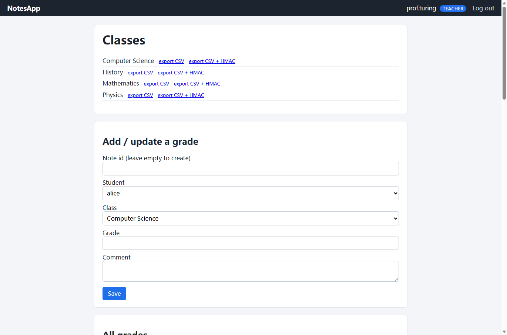
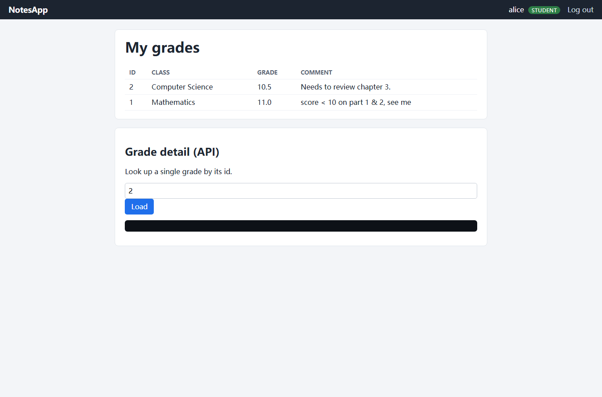

# Class 10 — Stored XSS

**WU YANLAN · 2023905420**

## What I expected

Before the test, I expected the browser to run a script stored in a grade comment,
because the dashboard template had autoescaping turned off. I expected the same
comment to show as plain text after restoring Jinja's default escaping. The
pre-run prediction is included separately.

## The comment ran in Alice's browser

I logged in as `prof.turing` and saved this comment on note 1, which belongs to
Alice:

```html
<script>alert('XSS by Eve')</script>
```

Alice then logged in normally and opened her dashboard. The server response
contained the unescaped script element. A real Edge browser opened the page and
reported a JavaScript dialog with the message **XSS by Eve**. This showed that
the comment was stored and ran when Alice viewed her page, without the teacher
being there.

The app encrypts comments in the database, but it decrypts them before rendering.
That does not stop XSS; the output still needs to be escaped.



The browser event and DOM details are in
`evidence/raw/alice-browser-before.json`.

## I put the escaping back

Both `dashboard.html` and `teacher.html` had the same unsafe wrapper. I removed
`autoescape false` and left the comment variable in the cell:

```html
<td>{{ n.comment }}</td>
```

After rebuilding, I saved and viewed the exact same script comment again. In
Alice's dashboard the browser showed the literal characters
`<script>alert('XSS by Eve')</script>` as text. Edge reported no dialog, and
there was no script element in the comment cell. I checked the teacher page too.





## Normal comments still work

I saved the ordinary comment:

```text
score < 10 on part 1 & 2, see me
```

On both pages the displayed text stayed the same. In the HTML, `<` and `&` were
escaped (`&lt;` and `&amp;`), so the browser displayed them as text rather than
interpreting them as markup.



## Result

The stored script executed before the fix and was inert after the fix. Removing
the unsafe template wrapper in both places restored default output escaping.
Alice's dashboard and the teacher's grade table still displayed normal comments.
