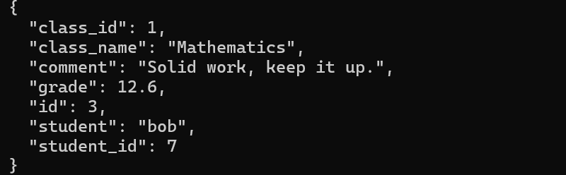

# Class 6 - Authentication, Part 1

**WU YANLAN (Viclant), student ID 2023905420**  
EPITA Computer Security | Report prepared 31 October 2026

## Read first

- [English report](Authentication-Part1-Wu-Yanlan.pdf)
- [Screenshot response excerpt](evidence/response-excerpt.png)
- [Evidence provenance](evidence/provenance.json)

This submission documents the existing local classroom experiment. It covers
Part 1 only. It does not repeat the request or claim that a repair was completed.

## Objective and scope

The classroom exercise asks whether an unsigned token can be accepted as an identity and expose another student's grade. This report organizes existing local evidence and explains it using a pinned source review. The experiment was not repeated while preparing this report. [1, 2]

## Before-run record

No original before-run prediction was preserved. No partner name was supplied. Neither is reconstructed after the event.

## Observed response

The preserved screenshot shows record ID 3, student bob (student ID 7), class Mathematics (class ID 1), grade 12.6 and comment: Solid work, keep it up.

## Evidence and its limits

The screenshot shows JSON returned in the local classroom request context. The existing script's unsigned mode and claimed teacher role are consistent with the exercise. The capture does not print the actual token or HTTP status and contains no unauthenticated control or server log. It therefore shows the returned record, while the script and source provide the explanation. It does not independently prove every request property or the current running configuration.

## Why it happened

Base64URL decoding makes claims readable; it does not prove their origin. Authentication depends on validation before those claims become an identity. In the reviewed code, this trust boundary is not enforced.

## Two separate access-control weaknesses

Authentication: verify_jwt accepts the unsigned case without establishing the authenticity of its claims. current_identity then uses those claims as the acting identity. Authorization: api_notes checks that an identity exists but does not restrict the selected grade to its owner or an assigned class. It does not check for a teacher role. Reading the record therefore cannot by itself prove that a claimed teacher role granted extra privileges. [2]

## Impact

Disclosure of grade and comment data. No grade modification or wider compromise is shown. Encryption at rest does not prevent plaintext disclosure when the application makes an inadequate access decision.

## Source anchor and version limits

Pinned source: Viclant/NoteApp, commit e4a88a5. web/app.py: verify_jwt 115-142; current_identity 144-151; api_notes 260-283. The historical screenshot is not proven to come from this exact build. Local uncommitted application changes are not part of this report's code reference.

## Proposed fixes

Enforce a signed-token policy chosen by the server, reject unsigned tokens for this API, and use a maintained verifier. Use a strong random signing secret. Check the identity and required claims, then separately enforce record ownership or assigned-class permissions. [2-4]

## Follow-up checks - not run

Reject unsigned, invalid, expired or wrong-audience credentials. Deny a student access to other students' records. Preserve legitimate student and assigned-teacher access. These are proposed checks, not passing results.

## Conclusion

The preserved response is consistent with the course's Part 1 finding: accepting unauthenticated claims can expose private records. Authentication and object authorization both need enforcement. The supplied slides place implementation of the JWT fixes in Class 7; this Part 1 submission makes no claim that a repair has been completed. [1]

## References

1. Kristen Pire, *Authentication Sessions JWT MFA.pdf*, supplied course deck,
   PDF pages 14-17 and 24 (printed slides 10/16, 11/16 and 12/16).
   The deck is not redistributed.
2. [Pinned NotesApp source at e4a88a5](https://github.com/Viclant/NoteApp/blob/e4a88a5a5e79f6307c99beb7b1506a2b870a4e99/web/app.py).
3. [RFC 8725](https://www.rfc-editor.org/rfc/rfc8725.html), sections 3.1-3.3
   and 3.5: algorithm policy, cryptographic validation and key quality.
4. [RFC 7519](https://www.rfc-editor.org/rfc/rfc7519.html), sections 4 and 7:
   claims and validation.

## Evidence handling and hand-in limits

The original `AutheP1.png` taskbar displays **27 October 2026, 17:19**.
This is a displayed computer time, not an independently authenticated timestamp.
The public figure is a response-only excerpt. Command lines and unrelated
desktop content are omitted; the visible response is unchanged. The original
remains local. Its SHA-256 and the crop coordinates are in the provenance file.

The exact course-platform submission format and any additional hand-in
instructions were not present in the supplied slides. No before-run prediction,
partner contribution, negative-control result or teacher acceptance is invented.
