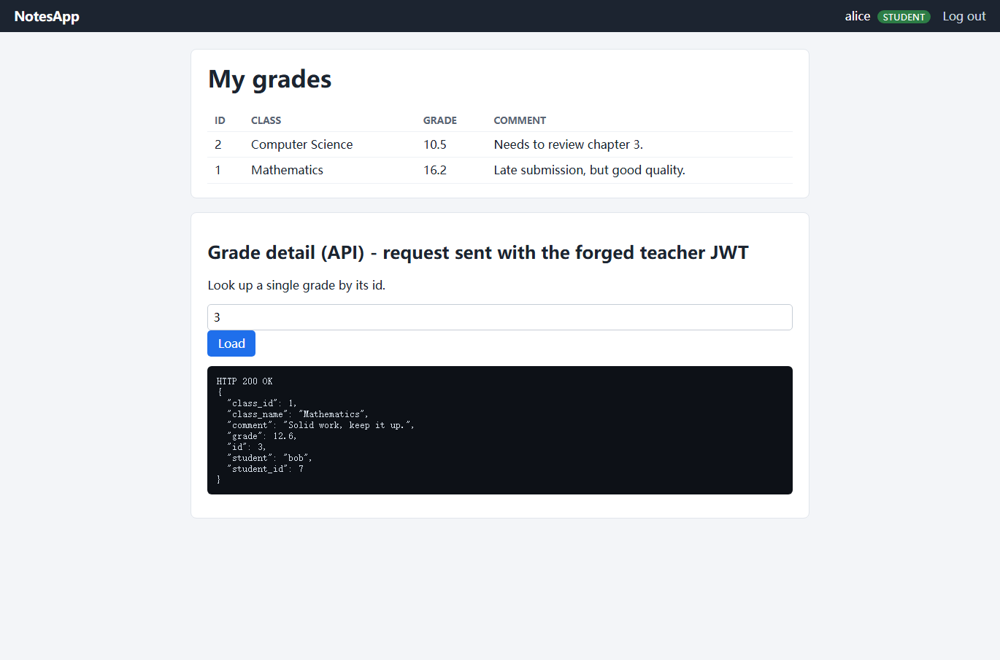
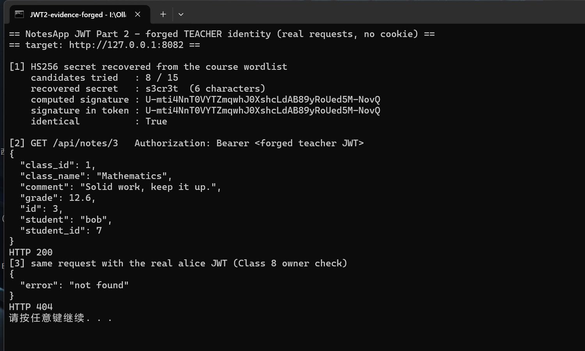
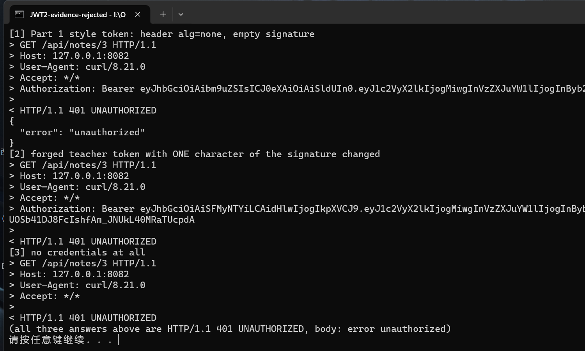

# JWT Part 2 - forging a teacher token on NotesApp

WU YANLAN | Student ID: 2023905420 | Class 6, Part 2 | 12 November 2026

## Finding

```text
What I read: Bob's Mathematics grade 12.6 and comment "Solid work, keep it up.", via /api/notes/3.
Break 1 (historical Part 1, not rerun): an unsigned alg:none token carrying a teacher claim; see the separate saved report.
Break 2 (this work): matched s3cr3t from the course wordlist and signed a valid HS256 teacher token.
Why it worked: accepting none can skip verification; rejecting none still leaves a guessable signing key that lets an attacker sign teacher claims.
```

## Prediction and record

The original Part 2 run did not save a separate pre-run prediction. Before the revision verification, at 18:43:04 UTC+8 on 12 November 2026, the assistant recorded this expectation after reviewing the source and prior results: the weak-key teacher token should work, unsigned or tampered tokens should fail, and the strong-key control should have no wordlist match. This is a revision prediction, not an independent first-attempt prediction. The observed results agreed.

## What I did and read

I used my own local NotesApp copy and synthetic seed data. I logged in only as alice / alicepw, then read the real server-issued JWT from the dashboard. Its header says HS256 and its payload says role=student:

```text
header:  {"alg":"HS256","typ":"JWT"}
payload: {"user_id":6,"username":"alice","role":"student"}
```

The payload is Base64url encoded, not encrypted: I decoded it locally without a key. Reading claims does not prove their authenticity. I computed HMAC-SHA256 over the real header.payload for each wordlist candidate, stopping when candidate 8 of 15, s3cr3t, reproduced the signature. The key is 6 characters, despite the course page's inconsistent reference to eight.

Using the recovered key, I signed a new teacher identity: user_id=2, username=prof.turing, role=teacher. This changed the identity claims, not just the role field. A cookie-free GET /api/notes/3 with that Bearer token returned HTTP 200: bob, Mathematics, grade 12.6, comment "Solid work, keep it up." No teacher password or teacher session was used.

## Why rejecting none is not enough

The Part 2 instance has JWT_ALLOW_NONE=false. It rejects an unsigned token, but a guessed HS256 key lets me compute a signature that the server accepts. Rejecting none closes the unsigned-token shortcut; it does not stop a correctly signed forged identity when the shared key is guessable.

A uniformly random 32-character key over an alphabet of A symbols has A^32 possible values; an exhaustive search needs about A^32/2 guesses on average. A 15-entry wordlist cannot recover a key absent from that list. This is a theoretical explanation, not a measured brute-force duration. I did not run the optional long brute force.

## Timing and scope

The preserved final original record at 18:17:28 reports 0.0004 s for 8 guesses, not all 15. The separate revision run at 18:49:07 reports 0.000073 s for 8 guesses. They are separate measurements; earlier auxiliary captures may show another sample. Part 1 was not repeated, and the Class 8 ownership check remained in place.

## HTTP checks

- No credentials -> Bob note 3: 401
- Unsigned alg:none -> Bob note 3: 401
- Real Alice token -> own note 1: 200; grade 16.2
- Real Alice token -> Bob note 3: 404
- Recovered-key teacher token -> Bob note 3: 200; grade 12.6
- Tampered signature -> Bob note 3: 401
- Recovered-key student token -> Bob note 3: 404
- Wrong signing key -> Bob note 3: 401

## Verification and cleanup

The revised scripts were run from a relocated copy, from a working directory outside the package, against fresh isolated databases on ports 8085 and 8086. Part 2 passed 8/8 status, body and no-Cookie checks. The optional strong-secret comparison tried all 15 candidates with no match, rejected the old forged token and unsigned token, and accepted a positive-control token signed with its actual private control key: 3/3 passed. That key was supplied only for the owner's positive control and was not used by the Part 2 recovery.

Four error checks passed: missing wordlist, empty wordlist, missing positive-control key, and attempted overwrite of existing evidence all returned nonzero exit codes. The evidence-page helper also made live local requests successfully. Both revision Compose projects were stopped using down without -v; their volumes were retained. Other pre-existing services were left running.

## What the screenshots prove

These three unchanged screenshots are original captures from the earlier local exercise, not new captures of the revision run. The browser picture retains Alice's session cookie; its API panel was driven by a real fetch with a forged Bearer token, and its heading and output were annotated by the capture script. The independent script HTTP matrix and curl transcript provide the no-Cookie proof. Normal Host and User-Agent headers may still be present.

The historical Part 1 report is included under references/part1. It preserves the saved Bob response and explains its evidence limits; it is not presented as a newly repeated Part 1 test. The original images and raw Part 2 results are unchanged. Fresh revision results and cleanup records are stored separately in evidence/revision-verification/.



Figure 1. Original browser capture: Alice's dashboard displays the live response to a forged teacher token. This browser capture carries Alice's session cookie; it is not the cookie-free proof.



Figure 2. Original curl capture: the forged teacher token reads Bob's note with HTTP 200; Alice's real token receives 404. The recovered key is s3cr3t.



Figure 3. Original curl capture: unsigned, tampered and anonymous requests are refused with HTTP 401. The API requests do not send a Cookie header.

Official exercise: https://github.com/KristenPire/epita-security-labs/blob/main/docs/class6/forge-a-token.md


# Reproduction and detailed checks

# Class 6 - JWT Part 2 submission

WU YANLAN | Student ID 2023905420

Start with `FINDING.txt` (the teacher's short finding) or
`Authentication-Part2-Wu-Yanlan.pdf` (three-page report with three original screenshots).
`REQUIREMENTS-CHECK.md` maps the exercise requirements. `TEST-RESULTS.md` records the checks.

## Repeat the local lab

Run the commands from this extracted submission folder. Python 3.10+ and Docker Compose
are required. The example uses ports 8085/8086 to avoid the older local exercises.
The source remains a classroom lab with its public weak key; the control is a separate
strong-secret comparison, not a claim that every teaching-app issue has been fixed.

```powershell
$env:PART2_PORT = "8085"
Push-Location .\lab
python setup_keys.py
docker compose up -d --build
Pop-Location
python .\scripts\part2.py --base http://127.0.0.1:8085 --out .\evidence\reruns\my-run
```

The default wordlist is found relative to the script's package root, regardless of the
working directory. Omitting `--out` creates a unique timestamped directory under
`evidence/reruns/`. An existing result or transcript will not be overwritten.
The script logs in only as Alice and matches HMAC signatures against the course list.
All eight API checks verify status, response content and absence of a Cookie header.

## Optional strong-secret comparison

```powershell
$env:CONTROL_PORT = "8086"
Push-Location .\class7-control
python setup_keys.py
docker compose up -d --build
Pop-Location
python .\scripts\part2-class7-control.py --base http://127.0.0.1:8086 --part2-results .\evidence\reruns\my-run\part2-results.json --out .\evidence\reruns\my-run
```

`class7-control/setup_keys.py` generates CONTROL_JWT_SECRET plus the encryption/HMAC
keys in its local `.env`, retaining existing values. The control script reads that
file by default for its mandatory positive control, or accepts `--secret-file` or
CONTROL_JWT_SECRET from the environment. It never prints or saves that private key.
The recovery script does not read this key. Missing inputs or checks cannot produce PASS.

## Stop both copies, retaining data

```powershell
Push-Location .\lab
docker compose down
Pop-Location
Push-Location .\class7-control
docker compose down
Pop-Location
```

Keep each generated `.env` with its data volume: encrypted comments need the same key
on the next start. No generated `.env` or database data is included in the submission.

## Evidence and dates

- Original final run: `evidence/part2-results.json`, 18:17:28 UTC+8, 8/8 passed,
  candidate 8 of 15 was `s3cr3t`, 0.0004 s. The 6-character spelling is intentional.
- Original images 01-10, raw transcripts and curl capture commands are unchanged.
  Auxiliary older captures may show another timing sample; they are not revision images.
- Revision: `evidence/revision-verification/summary.json`, fresh relocated stacks on
  8085/8086, 8/8 Part 2, 3/3 strong-secret control, 4/4 error checks, cleanup passed.
- `references/part1/` is historical reference only. Part 1 was not repeated.
- `scripts/cdp_shot.py` and `capture-terminal.ps1` are optional Windows capture helpers.
  The archived `.cmd` files in evidence retain their original machine paths; use the
  portable Python entry points above to repeat the experiment.
- Optional live page: `python scripts/part2-evidence-server.py --base http://127.0.0.1:8085 --port 8099`.
  It makes real requests when opened; it does not replay saved JSON as a live result.
- `manifest.json` lists file sizes and SHA-256, excluding itself, caches and local keys.

The original run did not save a separate Part 2 prediction. The report labels the
assistant's recorded pre-verification prediction as a later revision prediction.
This package has not been uploaded to GitHub or a course platform.


# Part 2 - recorded test results

All times are UTC+8 on 12 November 2026.

## Original final run

18:17:28, local port 8082. All 8 HTTP statuses matched. Actual Bob response: Mathematics, grade 12.6, comment "Solid work, keep it up.". The course list has 15 candidates; candidate 8 matched in 0.0004 s. See evidence/part2-results.json.

## Revision verification

18:48:51-18:49:12, copied to a different directory, with fresh isolated databases on 8085/8086. Default wordlist discovery was exercised from outside the package. Original evidence was not overwritten.

- No credentials -> Bob note 3: 401 - PASS (status, body and no-Cookie checked).

- Unsigned alg:none -> Bob note 3: 401 - PASS (status, body and no-Cookie checked).

- Real Alice token -> own note 1: 200; grade 16.2 - PASS (status, body and no-Cookie checked).

- Real Alice token -> Bob note 3: 404 - PASS (status, body and no-Cookie checked).

- Recovered-key teacher token -> Bob note 3: 200; grade 12.6 - PASS (status, body and no-Cookie checked).

- Tampered signature -> Bob note 3: 401 - PASS (status, body and no-Cookie checked).

- Recovered-key student token -> Bob note 3: 404 - PASS (status, body and no-Cookie checked).

- Wrong signing key -> Bob note 3: 401 - PASS (status, body and no-Cookie checked).


Strong-secret comparison: 15 candidates tried, no match. Old classroom-key token -> 401; unsigned -> 401; valid token signed with the actual private control key -> 200 and Bob's grade/comment. 3/3 PASS.

Error checks: missing wordlist, empty wordlist, missing positive-control key and existing output each returned a nonzero exit code. 4/4 PASS.

Live evidence page: real local requests and relative wordlist discovery PASS.

## Cleanup

Both jwt-part2-review-final-weak and jwt-part2-review-final-control were stopped with docker compose down, without -v. No containers remain for these projects; their volumes are retained. Existing 8080/8082/8083 services were not stopped.

## Problems repaired

The first revision attempt exposed an unterminated quote in the supplied control Dockerfile. It was repaired using the identical teaching image definition; the final clean build and tests passed. Initial-attempt logs remain under evidence/revision-verification/initial-attempt/.

Fixed package-relative paths, output overwrite protection, response-body assertions, required positive control, empty-input errors, old README claims, cookie wording and inconsistent timing. The control key is now generated locally instead of embedded in Compose.

## Not executed

Part 1 was not rerun. No long brute-force attack or measured full-keyspace duration is claimed. The 32-character-key discussion is theoretical. Original screenshots were retained rather than represented as new revision captures.

## Verification files

evidence/revision-verification/summary.json; part2/part2-results.json; control/class7-control.json; commands.json. These contain actual outputs and source/container hashes.
