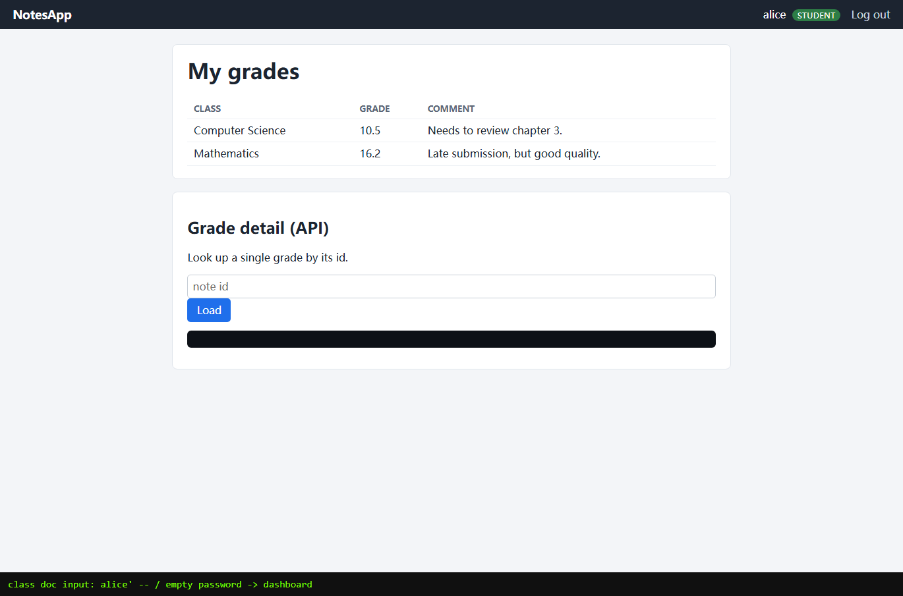
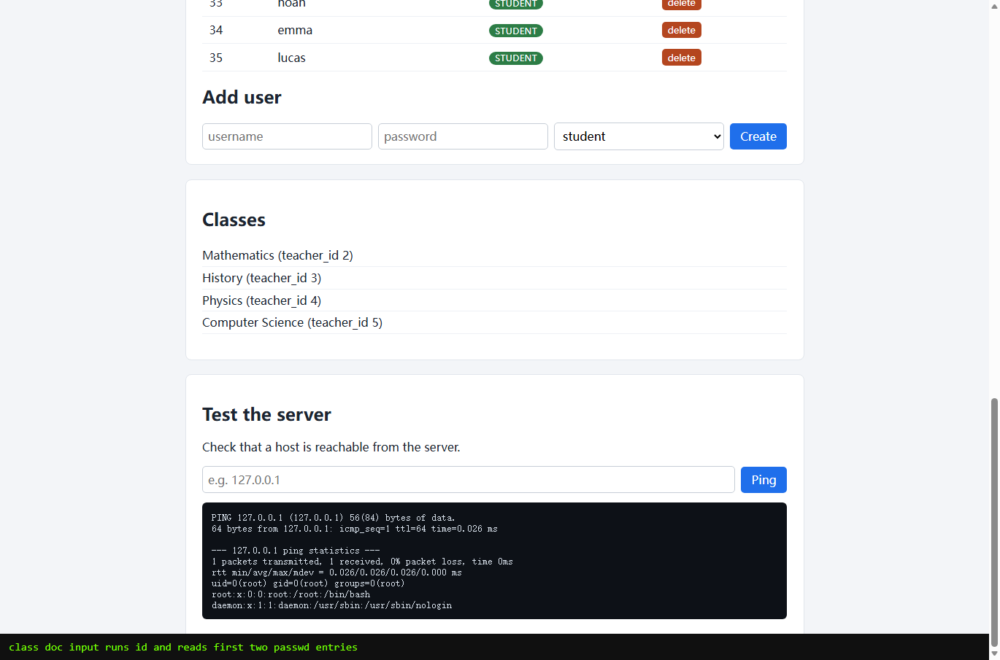

# Class 9 — Injection

**WU YANLAN · 2023905420**

## What I expected

Before the fresh test run, I predicted that `admin' -- ` would log in without the
password, because the quote closes the username and `--` comments out the rest of
the SQL condition. I also expected `127.0.0.1; id` to run a second command in the
admin ping form. After the fixes, both inputs should stop working, while normal
login and ping should still work. My prediction is in `PREDICTION.txt`.

## 1. SQL injection

I used the NotesApp revision that matches the query in the class handout (commit
`8d59164`). With username `admin' -- ` and password `anything`, the login returned
HTTP 302 and the admin page returned HTTP 200. I also tried `alice' -- ` with an
empty password; Alice's dashboard opened. This confirms that the password part of
the query was commented out.

The fix is to stop concatenating input into SQL:

```python
query = (
    "SELECT id, username, role FROM users "
    "WHERE username = %s AND password = %s"
)
cur.execute(query, (username, password))
```

After rebuilding, the same inputs returned “Invalid credentials”; `/admin` and
`/dashboard` redirected to login. A normal `alice` / `alicepw` login still opened
the dashboard.

**Figure 1.** The literal `alice' -- ` input opens Alice's dashboard before the fix.



## 2. Command injection

On the admin ping form I sent `127.0.0.1; id; head -2 /etc/passwd`. The ping
completed, then the shell ran the extra commands. The output included
`uid=0(root)` and the first two entries from `/etc/passwd`.

The fix uses an argument list and does not start a shell:

```python
result = subprocess.run(
    ["ping", "-c", "1", host],
    capture_output=True, text=True, timeout=10,
)
```

With the exact same host after rebuilding, ping treated the whole string as one
hostname. It failed to resolve it and printed no `id` or passwd output. A plain
`127.0.0.1` ping still worked.

**Figure 2.** The original ping form executed `id` as root and displayed passwd entries.



## Version note

The current NotesApp has changed since the query in the lesson: C5 moved password
verification to Python and added Argon2. Thus `admin' -- ` no longer bypasses the
password check in the current app. I tested the exact lesson input on the matching
older revision, and separately tested the remaining SQL concatenation on the
current app with UNION. The current app's fix keeps Argon2 and parameterises the
username; its patch is `injection-fix.patch`. The old and current results are kept
separate in `evidence/raw/`.

## Result

Both injection flaws were demonstrated and fixed. The same attacks failed after
the changes, and normal Alice login and a normal ping continued to work.
